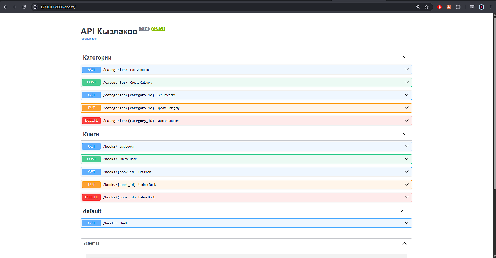
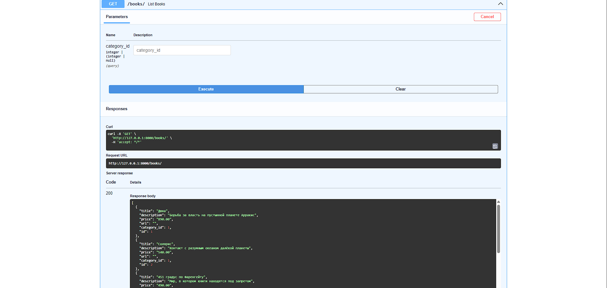
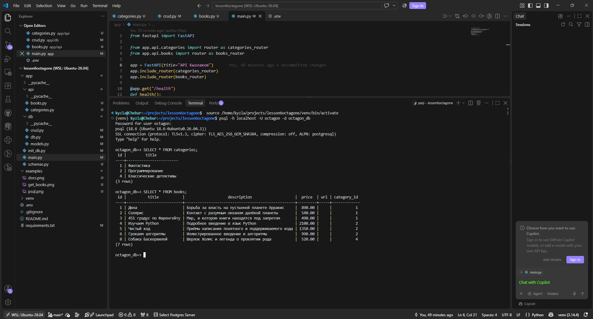

# lesson6octagone

## Структура

```
app/
├── db/
│   ├── db.py         ← подключение к базе: engine, Session, Base, get_db
│   ├── models.py     ← модели Category и Book
│   └── crud.py       ← функции работы с базой
├── api/
│   ├── categories.py ← эндпоинты категорий
│   └── books.py      ← эндпоинты книг
├── schemas.py        ← схемы Pydantic для запросов и ответов
├── init_db.py        ← создание таблиц и тестовые данные
└── main.py           ← приложение FastAPI
```

## Установка

```bash
python3 -m venv venv
source venv/bin/activate
pip install -r requirements.txt
```

Создать в корне проекта файл `.env`:

```
DB_HOST=localhost
DB_PORT=5432
DB_NAME=octagon_db
DB_USER=octagon
DB_PASSWORD=ваш_пароль
```

Создать таблицы и заполнить тестовыми данными:

```bash
python -m app.init_db
```

## Запуск

```bash
uvicorn app.main:app --reload
```

Открываем: http://127.0.0.1:8000/docs

## Эндпоинты

| Метод | Адрес | Описание |
|---|---|---|
| GET | `/health` | проверка, что сервер работает |
| GET | `/categories/` | список категорий |
| GET | `/categories/{id}` | категория по id |
| POST | `/categories/` | создать категорию |
| PUT | `/categories/{id}` | изменить категорию |
| DELETE | `/categories/{id}` | удалить категорию вместе с её книгами |
| GET | `/books/` | список книг, фильтр: `?category_id=` |
| GET | `/books/{id}` | книга по id |
| POST | `/books/` | создать книгу |
| PUT | `/books/{id}` | изменить книгу |
| DELETE | `/books/{id}` | удалить книгу |

## Скриншоты

Swagger:



Запрос `GET /books/`:



Данные в PostgreSQL:


